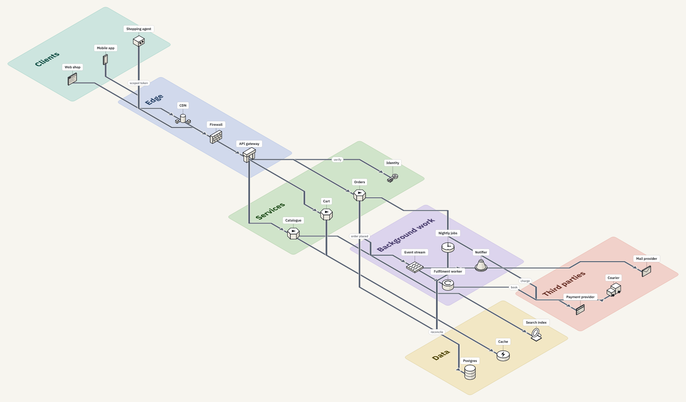

# isodia-mcp

Isometric architecture diagrams that agents and people draw together: an MCP server, a browser
canvas, revision history and share links, over one model.


*Unedited apart from the caption and pointer. The agent is a real MCP client calling
`build_diagram`, `edit_diagram`, `manage_views` and `share_project` while the canvas is open; the
person zooms in, drags an item, searches the icons and switches view. Every step lands in the history, and
the last scene is the read-only shared page. Recorded by
[`scripts/record-demo.ts`](scripts/record-demo.ts).*

The same diagram as the renderer exports it, from one `build_diagram` call
([`examples/storefront.ts`](examples/storefront.ts)); the layout, routing and artwork are isodia's:



Everything that draws or changes a diagram is this project's own: the model rules, the layout
engine, the renderer, the canvas and the icon set. Diagrams are stored in the open
[Isoflow](https://github.com/markmanx/isoflow) model format, so files move between isodia and
other tools that read it; isodia includes no Isoflow code and is not affiliated with it.

The canvas is one surface; the product is the **model, the history and the agent interface**.
Agents create, lay out, edit and render diagrams through MCP, and people get the same diagrams
in a browser with autosave, revision history and read-only share links. A person's edit on the
canvas and an agent's edit over MCP are the same operations, and the canvas is drawn by the
same renderer that exports the pictures.

## Quick start

```bash
bun install
bun start          # API + MCP over HTTP on :4400
bun run dev:web    # web app on :4401, proxying /api and /mcp to :4400
```

Open http://localhost:4401. Create a project, or let an agent do it (below).

For a single-origin deployment, build the web app once and let the API serve it:

```bash
bun run build      # writes dist/
bun start          # serves the app and the API together
```

The build is a normal deploy step, so run it in CI or at release time.

### Docker

```bash
docker build -t isodia-mcp .
docker run -p 4400:4400 -v isodia-data:/data \
  -e ISODIA_TOKEN="$(openssl rand -hex 32)" \
  -e ISODIA_URL=https://diagrams.example.com isodia-mcp
```

`ISODIA_URL` is the address clients reach, and it is what the Connect-agent panel and share
links print — set it to the public URL, not localhost. Projects live in `/data/isodia.db`, so
mount a volume or they are lost with the container; the image runs as the unprivileged `bun` user
and the volume is created with the right ownership. The image listens on all interfaces
(`HOST=0.0.0.0`), so it refuses to start without `ISODIA_TOKEN`, the bearer token the API and
the HTTP MCP endpoint then require.

The base image must be glibc, because `@resvg/resvg-js` ships a prebuilt native binary and does
not run on musl; the provided image is Debian-based, and most of its size is the Bun base. The
runtime stage installs production dependencies only, and the build fails unless that install can
check a model and render a picture.

## Connect an agent

The built-in panel (**Agent** on a project page) prints both configurations.

**stdio**, on the same machine — nothing to host:

```json
{
  "mcpServers": {
    "isodia": {
      "command": "bun",
      "args": ["/absolute/path/to/isodia-mcp/src/server/mcp-stdio.ts"]
    }
  }
}
```

**HTTP**, when the server is reachable over the network:

```json
{ "mcpServers": { "isodia": { "type": "http", "url": "http://localhost:4400/mcp" } } }
```

Both processes share one SQLite file (`ISODIA_DB`), so an agent over stdio and the web app
see the same projects. The default path is resolved from the repository, not the working
directory, so both find the same file however they are started.

Some MCP clients start stdio servers with a filtered environment. If you change
`ISODIA_DB`, set it explicitly in the server's `env` block as well, or the server falls back
to the default and appears empty.

### Tools

| Tool | Purpose |
| --- | --- |
| `list_projects`, `create_project`, `delete_project` | Project lifecycle |
| `get_diagram` | Read a view: items with tiles, connectors, regions, text |
| `build_diagram` | Replace a view with nodes/edges/groups, laid out automatically |
| `edit_diagram` | Atomic batch of edits: add, place, update, move, remove, connect, regions (draw, retitle, move with contents), text, `auto_layout` |
| `manage_views` | Create, rename, copy or delete views |
| `search_icons` | Find icon ids in the bundled set by keyword (`postgres` finds `database`) |
| `render_diagram` | PNG image or SVG source of a view |
| `list_revisions`, `restore_revision`, `save_checkpoint` | History |
| `share_project` | Create, list and revoke read-only share links |
| `export_project`, `import_project` | Model JSON (Isoflow format) in and out |

`render_diagram` returning a real image is what lets an agent check its own layout instead of
guessing.

Revision history keeps the newest 100 revisions, the original import and any revision named with
`save_checkpoint`; older unnamed autosaves are pruned so storage stays bounded. Each revision is a
full model snapshot, so name the ones worth keeping.

```bash
bun scripts/mcp-demo.ts                    # every tool over stdio, with a real MCP client
bun scripts/mcp-http-demo.ts               # the same over the HTTP endpoint
bun scripts/registration-check.ts          # handshake against the stdio entry point
```

`examples/busy.ts` is a worked example against a real repository: it builds five views
(deployment, message path, durable work, trust boundaries, repository map) through the MCP
server, saves a checkpoint and writes an SVG and a 1600 px PNG per view plus the model JSON.
`--png-only` skips the SVGs, which embed the icon artwork and are large. It runs against a live
server and recreates its own project each time:

```bash
PORT=4410 ISODIA_DB=/tmp/busy-docs.db bun src/server/index.ts &
bun examples/busy.ts --url http://127.0.0.1:4410 --out /tmp/busy-diagrams
```

## Model and layout

A project is one model: a shared list of **items** (name, icon, description) plus one or
more **views** that place those items on a tile grid. So "the same systems, for a different
audience" is a second view, not a second diagram.

`build_diagram` lays out a graph: edges flow from the upper left toward the lower right, each
group becomes a titled coloured region sized to hold its title, and regions never overlap. A
region's title sits on its own row inside its upper edge, so it never collides with the icon
artwork or labels of the items below. `edit_diagram` changes the layout surgically and leaves
everything else where it is.

Connector labels are placed on the route, not on the nearest tile: the renderer picks a free
tile with the most clearance from every item, closest to the middle of the route. A label on an
item's tile would vanish behind the icon, because items paint last, and two labels on one tile
would hide each other.

Every change is checked against the model schema (`src/core/schema.ts`) before it is stored:
whole-number tiles, unique ids, and every reference to an item, icon, colour or anchor resolved.
A model that cannot be drawn cannot enter the database.

## Icons

The bundled icons are generic nouns (`server`, `database`, `queue`, `user`, `gateway`…) drawn as
uncoloured isometric paper models and generated from code in `src/core/iconset/`. There are no
vendor logos: name the product in the item's label. Search answers to the names people use, so
`postgres`, `s3` or `lambda` find the right noun. A model can carry its own icons in `icons`
(any image as a data URI); they travel with the model and win over a bundled icon of the same
id. `bun scripts/icon-sheet.ts --out sheet.png` renders the whole set.

## The canvas

Tools are words in one bar: **Select** (click, drag to move, drag empty space to pan),
**Connect** (click one item, then another), **Region** (drag across tiles), **Text** (click a
tile), then **Add item**, **Undo**, **Redo** and **Tidy** (lay the view out again). The
selection's properties appear beside it and are shown on the canvas as you type. Dragging a
region moves what stands in it; a selected region resizes by its corner handles. The wheel pans,
Ctrl or Cmd with the wheel zooms. Keys: `V` `C` `R` `T` `I`, `Del`, `Esc`, `Ctrl+Z`,
`Ctrl+Shift+Z`. A share page is the same canvas, read-only: clicking an item shows its name and
notes.

## Design

One look runs through the app and the pictures it renders: warm paper, one ink, pale washes
for regions, neutral lines, IBM Plex, and a single orange accent kept for what an agent did
and where you are. [`DESIGN.md`](DESIGN.md) has the tokens, the rules for drawing a diagram,
the reasons, and the known debts. The values live in `src/core/theme.ts` and
`web/src/styles.css`.

Colours are stored in each model, so a project made before a palette change, or imported from
another tool, keeps the colours it was drawn with.

## Storage

One SQLite file (WAL, so several processes can share it):

- `projects` — the current model and a revision counter
- `revisions` — every saved state, with what made it (`editor`, `mcp`, `api`, `import`, `restore`)
- `share_links` — tokens granting read access to one project

Editor autosaves collapse into one revision per two-minute burst, so a burst of keystrokes does
not bury the history. Agent edits and checkpoints always stand alone.

Optimistic concurrency: the editor saves against the revision it loaded. If an agent changed the
project meanwhile, the save is refused (`409`) and the browser shows the newer revision.

## Configuration

| Variable | Default | Meaning |
| --- | --- | --- |
| `HOST` | `127.0.0.1` | Interface to listen on. Anything but localhost requires `ISODIA_TOKEN` |
| `PORT` | `4400` | HTTP port |
| `ISODIA_DB` | `data/isodia.db` | SQLite file shared by all processes |
| `ISODIA_URL` | `http://localhost:$PORT` | Public base URL used in links and MCP output |
| `ISODIA_TOKEN` | unset | When set, the API, `/mcp` and the app require `Authorization: Bearer <token>` |

Share links are always public: the token is the credential. That is what makes a shared diagram
openable by a client without an account.

## Security

- **Local only by default.** The server listens on `127.0.0.1` with no authentication, so only
  programs on this machine can read, change and delete projects through the API and `/mcp`.
- **Serving other machines needs a token.** Setting `HOST` to anything but localhost makes the
  server refuse to start unless `ISODIA_TOKEN` is set. The Docker image sets `HOST=0.0.0.0`.
- **Custom icons are inline pictures.** An icon `url` must be a `data:image/…` URL; file paths
  and remote addresses are rejected, on import too.
- **A share link is a credential.** Anyone holding it can read that project until you revoke it.
- **Diagram text is user content and is only ever shown as text.** Names, labels and notes are
  escaped by the renderer and reduced to plain text by the canvas; no HTML from a model is
  inserted into the page. A model's own icons are images shown through SVG `<image>`, which
  does not run scripts.
- The stdio MCP server has the same access as the user who starts it; it does not check the token.

Report vulnerabilities privately through the repository's security advisories, not public issues.

## HTTP API

`GET/POST /api/projects`, `GET/DELETE /api/projects/:id`, `PUT /api/projects/:id/model`,
`POST /api/projects/:id/build`, `POST /api/projects/:id/operations`,
`GET /api/projects/:id/render`, `GET /api/projects/:id/export`,
`GET /api/projects/:id/revisions`, `POST /api/projects/:id/revisions/:n/restore`,
`POST /api/projects/:id/checkpoints`, `GET/POST /api/projects/:id/shares`,
`DELETE /api/shares/:token`, `GET /api/icons`, `POST /mcp`,
and the public `GET /api/shared/:token`.

## Tests

```bash
bun test                                      # unit and integration suites
bun scripts/seed-demo.ts                       # rebuild the two demo projects the browser check drives
export CHROME_PATH=/usr/bin/chromium           # any Chrome or Chromium binary
bun scripts/browser-check.ts                  # browser smoke test; needs both dev servers
bun scripts/mcp-demo.ts                       # MCP over stdio, end to end
bun scripts/mcp-http-demo.ts                  # MCP over HTTP, end to end
```

`browser-check.ts` expects the `payments-platform` and `acme-retail-platform` demo projects, so run
`seed-demo.ts` first on a fresh database. Both scripts read `API_URL`/`WEB_URL` and default to the
dev ports; the browser check also needs `CHROME_PATH`. It drives every canvas tool on a scratch
project, checks each edit against what the server stored, and exits non-zero when a step fails
or when a page logs an error, a failed request or an uncaught exception. The only complaint it
expects, and discounts, is the 404 for the share link it revokes.

Both serving modes are covered. Point both variables at a single-origin server to check the
production path, where no proxy sits in front of `/api` or `/mcp`:

```bash
bun run build
PORT=4500 ISODIA_URL=http://127.0.0.1:4500 bun src/server/index.ts &
API_URL=http://127.0.0.1:4500 bun scripts/seed-demo.ts
WEB_URL=http://127.0.0.1:4500 API_URL=http://127.0.0.1:4500 bun scripts/browser-check.ts
```

CI owns the full build and test gates; `bun run build` is a deploy step, not part of a code
change.

## Notes

- Stored models keep only their own icons. Bundled icons are resolved by id when a model is
  drawn, and embedded on export so the file is complete on its own.
- Import and export run through the server, so history and validation always apply.
- A model made elsewhere that names an icon it does not carry, and that the bundled set does
  not have (a vendor icon from another tool's pack, for example), is refused with the icon's
  name. Embed the icon in the file's `icons`, or change the item to a bundled noun.

## Licence

MIT, see [`LICENSE`](LICENSE): the code and the icon artwork. The dependencies keep their own
licences, all permissive or weak-copyleft and none modified; [`NOTICE.md`](NOTICE.md) lists
them, and should travel with anything you ship or host.
